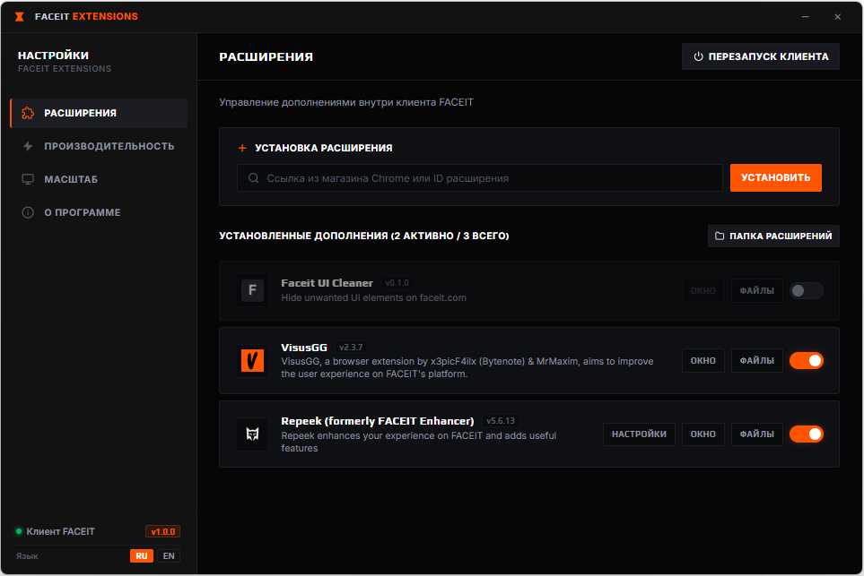

# Faceit Extensions

  
  
  
  

Быстрая и легкая модификация десктопного клиента FACEIT со встроенным набором популярных расширений, аппаратным ускорением GPU и аутентичным темным интерфейсом.

Клиент можно спокойно держать открытым на втором мониторе во время игры в Counter Strike 2 без просадок FPS и перегрузки оперативной памяти.

  

## Возможности

* **Аппаратное ускорение GPU**: устраняет баг клиента с программным рендерингом через процессор, снижая нагрузку на CPU в фоне до 0%
* **Оптимизация оперативной памяти**: лимит кучи V8 JavaScript и автоматический сброс кэша при переключении в окно игры
* **Блокировка телеметрии**: отключает тяжелые трекеры sentry.io и datadoghq.com для чистой работы сети без микрофризов
* **Встроенные расширения в один клик**: Repeek, Faceit UI Cleaner и VisusGG уже включены в сборку
* **Настоящий дизайн FACEIT**: стильные темные цвета #121212 и #060606, кастомный заголовок окна и поддержка перетаскивания
* **Двуязычный интерфейс**: автоопределение русского или английского языка под ваш клиент и систему
* **Автоматические обновления**: клиент сам проверяет новые версии на GitHub и обновляет файлы в один клик

## Безопасность

* 100% безопасно для FACEIT Anti Cheat
* Модификация работает только внутри веб интерфейса клиента в папке AppData
* Не трогает файлы игры cs2.exe, не читает память и никак не касается драйвера faceit.sys
* Все встроенные расширения разрешены платформой и используются миллионами игроков в браузерах

## Установка

1. Скачайте архив репозитория через кнопку Code ➔ Download ZIP и распакуйте
2. Полностью закройте клиент FACEIT
3. Запустите install.bat (или правой кнопкой мыши по install.ps1 ➔ Выполнить с помощью PowerShell)
4. Скрипт создаст резервную копию файлов, внедрит загрузчик и запустит готовый клиент

## Горячие клавиши

* **Ctrl + Shift + E**: открыть меню настроек Faceit Extensions
* **Ctrl + Колесо мыши**: изменить масштаб интерфейса
* **Ctrl + 0**: сбросить масштаб на стандартный
* **F12**: открыть консоль разработчика

## Автообновление

При запуске клиент проверяет файл version.json на GitHub. Когда выходит новая версия, прямо в клиенте появляется кнопка обновления. Нажмите ее, и файлы обновятся автоматически с перезапуском клиента.

## Удаление

Чтобы вернуть клиент к заводскому состоянию:
1. Запустите uninstall.bat
2. Скрипт восстановит оригинальный app.asar из резервной копии и удалит добавленные модули

## Сообщество и поддержка

* Официальный Telegram канал разработчика: https://t.me/KreziBro_dev
* Поддержать развитие проекта на платформе Ko-fi: https://ko-fi.com/krejzibro

## Лицензия

Распространяется под лицензией MIT. Подробности в файле [LICENSE](LICENSE).
